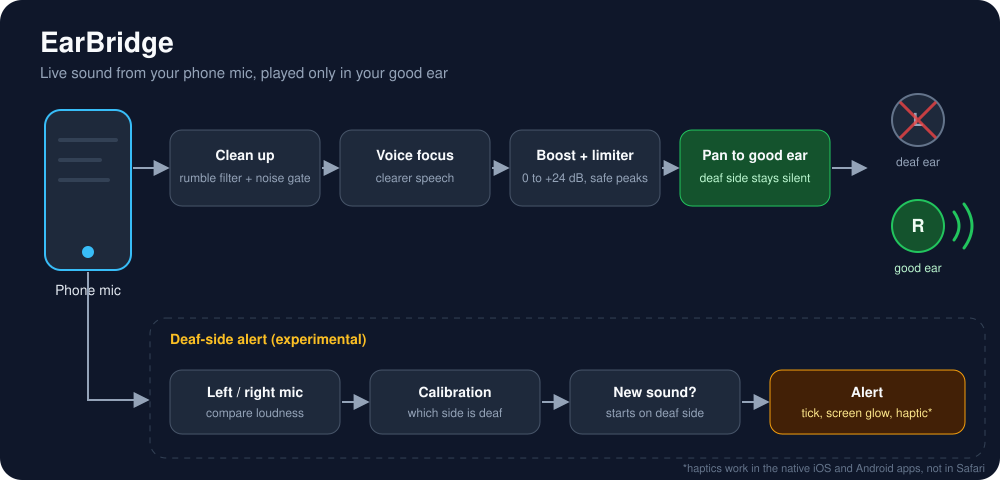
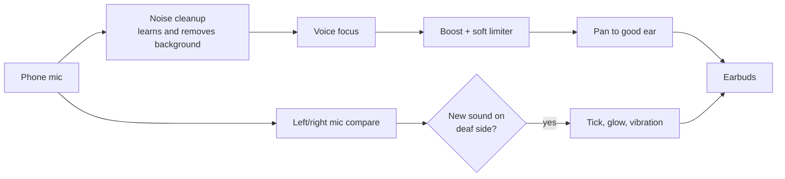

# EarBridge

**Hear your surroundings in your good ear, using any earbuds.**

EarBridge is a free web app for people who are deaf in one ear. It listens through the phone mic and plays the live sound only into the earbud on the hearing side, so you pick up conversations from your deaf side too. It is a software take on the idea behind CROS hearing aids.



> **Status:** early prototype. Not a medical device and not a replacement for an audiologist.

## Try it now

No install needed. It runs in your phone browser.

1. Open the live page: `https://YOUR-USERNAME.github.io/YOUR-REPO/` (replace with your own GitHub Pages link).
2. Tap **Share, then Add to Home Screen** to keep it like an app.
3. Pair your earbuds, then open EarBridge.
4. Pick your **deaf ear**, tick the earbuds box, tap **Start listening**.
5. In the Microphone list choose the **phone's own microphone**, not your earbuds.
6. Keep the screen on. Start with low volume and raise it slowly.

## What it does

| Feature | Status |
|---|---|
| Live sound to the good ear only | Yes |
| Works with any earbuds, wired or Bluetooth | Yes |
| Volume boost, 0 to +24 dB, smooth with no clicks | Yes |
| Voice focus for clearer speech | Yes |
| Noise cleanup that learns and removes steady background noise | Yes |
| Soft limiter against harsh peaks and squealing | Yes |
| Automatic recovery after calls and notification sounds | Yes |
| Deaf-side alert: tick in good ear and screen glow | Experimental |
| Deaf-side alert: vibration | Only where the browser allows it (Safari does not) |

## How it works



- **Phone mic on purpose.** Earbud mics force Bluetooth into low-quality call mode.
- **Noise cleanup** uses spectral noise reduction. It keeps a running estimate of the steady background (fans, traffic, hiss) for each frequency and turns those parts down while leaving voices. Start at 6 out of 10. Very high settings can make voices sound thin.
- **Boost** changes smoothly, then passes through a compressor and a soft limiter. If sound stays near the maximum, the app lowers the volume by itself to stop squealing or harsh distortion.
- **Calls and notifications** can pause the microphone. EarBridge watches for this and resumes on its own. If the phone refuses, an orange **Tap to resume** button appears.
- **Deaf-side alert** compares loudness on the phone's two mic channels. You calibrate once by clapping on your deaf side. It only works if the browser gives a real two-channel mic.

## For music, calls and videos

No web page can capture other apps' audio. Use the phone's system setting instead: on iPhone, Settings > Accessibility > Audio & Visual, turn on **Mono Audio** and slide **Balance** to your good ear. On Android, Settings > Accessibility > Audio adjustment.

## Tips for the best sound

- Move the phone closer to the person talking instead of using a very high boost. Above +18 dB it adds hiss.
- Use the phone mic and keep it uncovered.
- Wired or LE Audio earbuds have the least delay.

## Known limits

- Normal Bluetooth earbuds add about 150 to 250 ms delay. A little echo against the real sound is normal on Bluetooth.
- Noise cleanup cannot separate a voice from another voice or from music.
- Do not rely on EarBridge for traffic or safety. The phone mic can miss sounds from your deaf side.
- Browsers pause web audio if the screen locks, so keep the screen on.
- True per-earbud direction sensing needs mics in each bud, which phones do not expose.

## Files

```
index.html         the whole app in one file
architecture.svg   the overview illustration
README.md          this file
```

## Safety

Start quiet and raise the volume slowly. The soft limiter protects against sudden peaks, but you are still responsible for a safe listening level. Talk to an audiologist about CROS or bone-conduction options for permanent use.

## License

Add a `LICENSE` file of your choice (MIT is a common pick for open projects).
