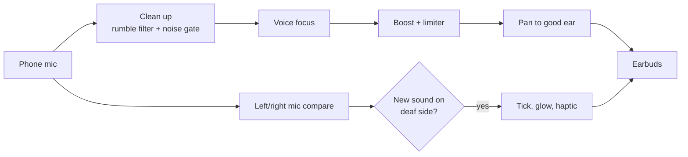

# EarBridge

**Hear your surroundings in your good ear, using any earbuds.**

EarBridge is a free prototype for people who are deaf in one ear. It listens through the phone mic and plays the live sound only into the earbud on the hearing side, so you pick up conversations from your deaf side too. It is a software take on the idea behind CROS hearing aids.


> **Status:** early prototype. Not a medical device and not a replacement for an audiologist. Not fully tested on real phones yet.

## Try it now (web version)

The fastest way, no install, works on iPhone and Android.

1. Open the live page: `https://YOUR-USERNAME.github.io/YOUR-REPO/web/` (replace with your own GitHub Pages link).
2. In Safari tap **Share, then Add to Home Screen**.
3. Pair your earbuds and open EarBridge.
4. Pick your **deaf ear**, tick the earbuds box, tap **Start listening**.
5. In the Microphone list choose the **iPhone microphone**, not your earbuds.
6. Keep the screen on. Start with low volume and raise it slowly.

## What it does

| Feature | Web | iOS app | Android app |
|---|---|---|---|
| Live sound to the good ear only | Yes | Yes | Yes |
| Works with any earbuds | Yes | Yes | Yes |
| Volume boost (0 to +24 dB) | Yes | Yes | Yes |
| Voice focus (clearer speech) | Yes | Yes | Yes |
| Safety limiter | Yes | Yes | Yes |
| Noise cleanup (adaptive gate) | Yes | Planned | Planned |
| Deaf-side alert: tick and screen glow | Experimental | Planned | Planned |
| Deaf-side alert: vibration | No (Safari blocks it) | Planned | Planned |
| Keeps running with screen locked | No | Yes | Yes |
| Stops if sound would go to phone speaker | No (confirm tickbox) | Yes | No |

## How it works



- **Phone mic on purpose.** Earbud mics force Bluetooth into low-quality call mode.
- **Noise cleanup** learns the steady background level and quiets it between sounds. It cannot remove noise while someone is talking.
- **Deaf-side alert** compares loudness on the phone's two mic channels. You calibrate once by clapping on your deaf side. It only works if the browser or phone gives a real two-channel mic.

## Repo layout

```
web/       index.html, the single-file web app (start here)
ios/       SwiftUI app (AVAudioEngine), built with XcodeGen
android/   Kotlin app (Jetpack Compose, AudioRecord and AudioTrack)
docs/      architecture.svg
.github/   GitHub Actions workflow that builds the iOS app without a Mac
```

## Build the iOS app without a Mac

1. Open the **Actions** tab of this repo.
2. Choose **Build iOS app** and tap **Run workflow**.
3. When it finishes, download the **EarBridge-ipa** file.
4. Install it with [Sideloadly](https://sideloadly.io) on Windows or Mac using a free Apple ID. Free-account apps expire after 7 days, so re-install weekly. A paid Apple Developer account ($99/year) removes that limit and allows TestFlight.

With a Mac and Xcode:

```bash
brew install xcodegen
cd ios && xcodegen && open EarBridge.xcodeproj
```

Then pick your team under Signing & Capabilities and press Run.

## Build the Android app

Open the `android` folder in Android Studio, let Gradle sync, plug in a phone, press Run.

## For music, calls and videos

No app can capture other apps' audio. Use the system setting instead: **iPhone** Settings > Accessibility > Audio & Visual, turn on **Mono Audio**, slide **Balance** to your good ear. On Android: Settings > Accessibility > Audio adjustment.

## Known limits

- Normal Bluetooth earbuds add about 150 to 250 ms delay. Wired or LE Audio earbuds are much faster. A little echo against the real sound is normal on Bluetooth.
- Do not rely on EarBridge for traffic or safety. The phone mic can miss sounds from your deaf side.
- Safari pauses web audio if the screen locks, so keep the screen on.
- True per-earbud direction sensing needs mics in each bud, which phones do not expose.

## Roadmap

- [ ] Noise cleanup in the iOS and Android apps
- [ ] Native haptic alert on deaf-side sounds (iOS and Android)
- [ ] Better direction sensing using the phone's multiple mics
- [ ] LE Audio low-latency mode
- [ ] Saved profiles for different earbuds and places

## Safety

Start quiet and raise the volume slowly. The built-in limiter protects against sudden peaks, but you are still responsible for a safe listening level. Talk to an audiologist about CROS or bone-conduction options for permanent use.

## License

Add a `LICENSE` file of your choice (MIT is a common pick for open projects).
